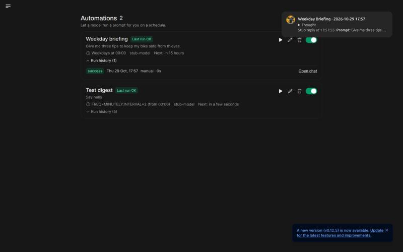
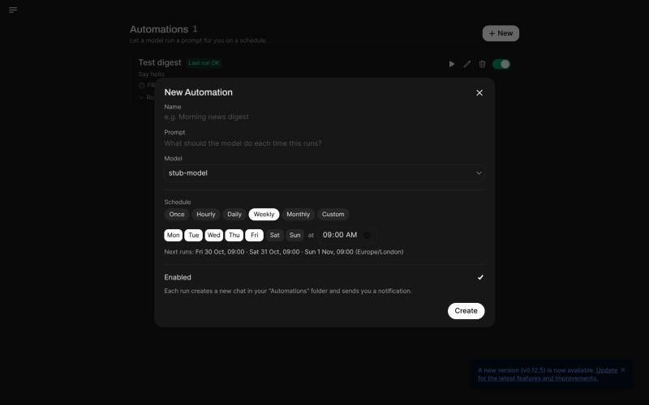

<p align="center">
  
</p>

<h1 align="center">Anti-Theft WebUI</h1>

<p align="center">
  A self-hosted AI chat app, forked from <a href="https://github.com/open-webui/open-webui/tree/v0.6.5">Open WebUI v0.6.5</a>,<br/>
  with its own branding and <b>scheduled automations</b>.
</p>

---

## What is different from Open WebUI 0.6.5

|                              |                                                                                                    |
| ---------------------------- | -------------------------------------------------------------------------------------------------- |
| 🎨 **Own branding**          | Every logo, favicon and splash screen is replaced. One script regenerates them all from any image. |
| ⏰ **Scheduled automations** | Let a model run a prompt for you on a schedule: "every weekday at 8:00, summarize the news".       |
| 📜 **Permissive license**    | Based on the last BSD-3-Clause release of Open WebUI.                                              |

Everything else (chat, Ollama and OpenAI-compatible models, RAG, tools, web search, channels, …) works as in
Open WebUI 0.6.5. See the [original README](docs/UPSTREAM_README.md) for that feature list.

## Scheduled automations



- Open **Automations** in the sidebar and press **New**.
- Give it a name, a prompt and a model.
- Pick when it runs: **once**, **every N hours**, **daily**, **weekly** (pick the days), **monthly**, or a
  **custom** iCalendar rule such as `FREQ=WEEKLY;BYDAY=MO,WE;INTERVAL=2`.
- The dialog shows the next three run times before you save.
- Optionally let each run **search the web** first.



Each run:

1. creates a normal chat in an **Automations** folder, so you can read it and keep chatting;
2. tells the model the current date and time, and that nobody is watching live;
3. uses the model's tools and knowledge, like a normal chat;
4. sends you a pop-up notification, and your webhook if you are away.

Every automation has **Run now**, **Edit**, **Pause/Resume** and **Delete**, plus a **run history** with the
status of each run and a link to its chat.

### How it works

- A schedule is stored as an iCalendar `RRULE`, a start time and the user's IANA timezone (e.g.
  `Europe/Amsterdam`). It is expanded in local wall-clock time, so "every day at 09:00" stays at 09:00 when the
  clocks change for summer and winter.
- A small scheduler inside the backend checks for due automations. It claims each due run with an atomic
  compare-and-swap update, so with several workers on one database a run still happens only once.
- If the server was down, missed runs are merged into one run on restart. They do not all fire at once.
- Runs left half-finished by a restart are marked as failed.

### Settings

Admins can turn automations off for a group: **Admin → Users → Groups → Permissions → Features → Automations**.

| Environment variable                    | Default | Meaning                                       |
| --------------------------------------- | ------- | --------------------------------------------- |
| `ENABLE_AUTOMATIONS`                    | `True`  | Turn the feature and scheduler on or off      |
| `USER_PERMISSIONS_FEATURES_AUTOMATIONS` | `True`  | Default permission for normal users           |
| `AUTOMATION_MAX_COUNT`                  | `20`    | Max automations per non-admin user            |
| `AUTOMATION_MIN_INTERVAL`               | `300`   | Shortest gap between two runs, in seconds     |
| `AUTOMATION_POLL_INTERVAL`              | `30`    | How often the scheduler checks, in seconds    |
| `AUTOMATION_MAX_CONCURRENT`             | `3`     | How many runs may use models at the same time |

### API

All endpoints are under `/api/v1/automations` and need a signed-in user.

| Method   | Path           | What it does                                    |
| -------- | -------------- | ----------------------------------------------- |
| `GET`    | `/`            | List your automations, with each one's last run |
| `POST`   | `/create`      | Create one                                      |
| `POST`   | `/preview`     | Check a schedule and get its next run times     |
| `GET`    | `/{id}`        | Get one                                         |
| `GET`    | `/{id}/runs`   | Run history (last 20)                           |
| `POST`   | `/{id}/update` | Change one                                      |
| `POST`   | `/{id}/toggle` | Pause or resume                                 |
| `POST`   | `/{id}/run`    | Run now, in the background                      |
| `DELETE` | `/{id}/delete` | Delete it and its history (chats are kept)      |

## Run it

You need **Python 3.11** and **Node.js 18–22** (Node 24 is not supported by this version).

```bash
# 1. Backend dependencies
python3.11 -m venv .venv
.venv/bin/pip install -r backend/requirements.txt

# 2. Build the web app
npm ci
npm run build

# 3. Start (open http://localhost:8080)
cd backend
WEBUI_SECRET_KEY="$(openssl rand -hex 32)" ../.venv/bin/uvicorn open_webui.main:app --host 0.0.0.0 --port 8080
```

The first account you create becomes the admin. Add models under **Admin → Settings → Connections**
(Ollama or any OpenAI-compatible API). Data is stored in `backend/data`.

To open it from your phone on the same Wi-Fi, use `http://<your-computer's-IP>:8080`.

### Docker

The original `Dockerfile` is unchanged, so a normal build should work. It has not been tested in this fork.

```bash
docker build -t anti-theft-webui .
docker run -d -p 3000:8080 -v anti-theft-webui:/app/backend/data --name anti-theft-webui anti-theft-webui
```

## Use your own logo

```bash
.venv/bin/pip install pillow   # if not installed
python3 scripts/rebrand_logo.py path/to/logo.png
# optional separate image for dark mode:
python3 scripts/rebrand_logo.py path/to/logo.png --dark path/to/logo-dark.png
```

This writes every favicon, app icon, splash and logo file into `static/` and `backend/open_webui/static/`.
Then rebuild with `npm run build`.

## License and credits

This project is based on [Open WebUI](https://github.com/open-webui/open-webui) **v0.6.5** by Timothy Jaeryang
Baek and contributors. That release is under the **BSD-3-Clause** license, kept unchanged in [LICENSE](LICENSE).

Later Open WebUI releases use a different license that forbids changing the branding (with some exceptions).
**This fork contains no code from those later releases.** The automations feature was written from scratch,
based only on the public description of the idea. Please keep it that way: do not copy code from Open WebUI
releases newer than v0.6.5 into this repository. For security fixes, read the public advisory and write the
fix yourself.

The anti-theft logo belongs to the Anti-Theft Kit project.
